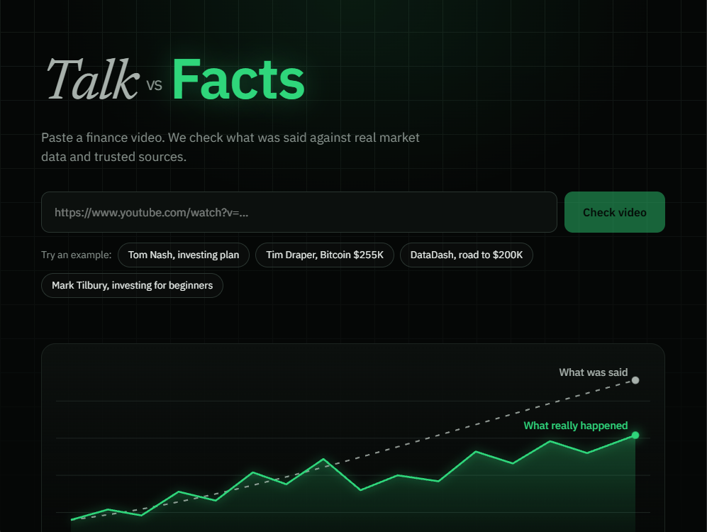
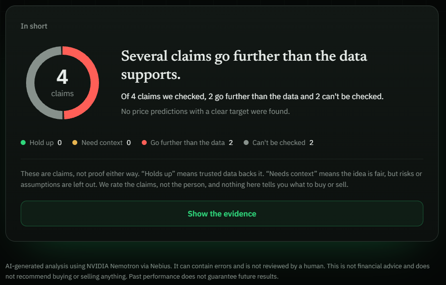
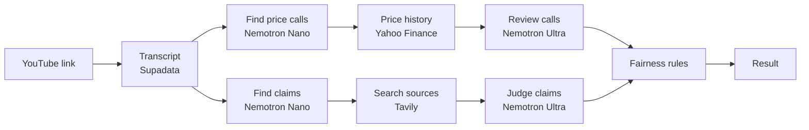

<div align="center">

# Talk vs Facts

### Finance videos, checked against the data.

[](https://talk-vs-facts.vercel.app)


[Live app](https://talk-vs-facts.vercel.app) | [How it works](#how-it-works) | [Run it locally](#run-it-locally)

<br />



</div>

<br />

## The problem

Millions of people learn about money from finance influencers on YouTube and social media. A study by Kakhbod, Kazempour, Livdan and Schürhoff (Swiss Finance Institute, 2023) looked at finfluencers on the investing platform StockTwits. Only 28% showed real skill. 56% were "antiskilled": following their advice did worse than the market. And the unskilled ones tended to have more followers.

Most finance videos aren't lies, and they aren't proof either. They're claims. Some hold up, some leave out the risks, and some go further than the data. Viewers have no quick way to tell which is which.

## What it does

Paste a YouTube link. In one to two minutes you get:

- **A short answer** anyone can read in five seconds, with a chart of how the claims hold up
- **Price calls** like "Bitcoin to $100k by the end of 2024", checked against real price history from the day the video came out
- **Market claims** like "the S&P 500 returns 10% a year like clockwork", checked against sources such as the Federal Reserve, IMF, World Bank, S&P Dow Jones Indices, Vanguard, Fidelity and Morningstar
- **The full evidence** for every claim: the exact quote, what the sources say, the risks left out, and a link to each source

<div align="center">

</div>

## How it works



Price calls and claims are checked in parallel to keep it fast.

### Two Nemotron models, two jobs

I use both models through **Nebius Token Factory**, each where it's strongest:

| Model | Job | Why |
|---|---|---|
| Nemotron 3 Nano | Reading the transcript, finding price calls and claims | Fast and cheap. Thinking is turned off because this is extraction, not reasoning |
| Nemotron 3 Ultra | Judging each claim and price call | Needs real reasoning: comparing time periods, doing compound interest math, spotting when "always" goes further than the data |

### Evidence with Tavily

Every claim gets two searches: one to check it, one to look for risks and counter evidence. Searches are limited to an allow list of trusted domains (central banks, the IMF, index providers, large asset managers, university research), and social media is blocked. Ultra only sees the sources Tavily actually returned.

## Trust and fairness

This app talks about real people, so being fair matters more than being dramatic. The key rules live in code, not just in prompts:

- **Quotes are verified.** Every quote is matched against the real transcript. If the words aren't in the video, the claim is dropped.
- **Deadlines are verified.** A price call only gets a deadline if the exact words stating it appear in the transcript.
- **Sources are verified.** Any citation that doesn't point to a source Tavily returned is removed.
- **The claim has to match the quote.** If it's stronger or different from what was actually said, it's dropped.
- **Negative labels need strong evidence.** "Overstated" needs 60% confidence, "Data disagrees" needs 75%. Below that, it's "Can't verify".
- **No "wrong" for the future.** Claims about the future, or with unclear time words like "this year", can't be marked as wrong.
- **Strong words get checked.** "Always", "impossible" or "like clockwork" can't get "Holds up" when the data shows exceptions.
- **Claims are rated, never people.** No rankings of creators, and no results are stored.

## Labels

| Label | Meaning |
|---|---|
| Holds up | Trusted sources confirm it as it was said |
| True so far, not guaranteed | About the future, backed by long term data |
| Needs context | Fair idea, but risks, assumptions or time frames are left out |
| Overstated | Gives a clearly stronger impression than the data supports |
| Data disagrees | A trusted source directly contradicts it for the same measure and period |
| Can't verify | The sources don't clearly answer it |
| Opinion | A personal belief that can't be checked with data |

## Tech stack

| Layer | Tools |
|---|---|
| App | Next.js 16 (App Router), TypeScript, hosted on Vercel |
| AI | NVIDIA Nemotron 3 Nano and Nemotron 3 Ultra via Nebius Token Factory |
| Search | Tavily, with domain allow list |
| Data | Supadata (transcripts), Yahoo Finance (price history) |

## Run it locally

```bash
git clone https://github.com/Housofalex/talk-vs-facts.git
cd talk-vs-facts
npm install
```

Create a `.env.local` file in the project folder:

```
NEBIUS_API_KEY=your_key
TAVILY_API_KEY=your_key
SUPADATA_API_KEY=your_key
```

Start the app:

```bash
npm run dev
```

Then open http://localhost:3000

## Project structure

```
app/
  page.tsx            Homepage and results
  [slug]/page.tsx     How we check, Disclaimer, Privacy, Terms, Contact
  Intro.tsx           Opening animation
  Dive.tsx            Page transitions
  api/
    transcript/       Transcript and video info
    extract/          Price call extraction
    check/            Price history check
    judge/            Price call review
    claims/           Claim extraction, evidence search and verdicts
```

## Challenges I ran into

- **YouTube blocks servers.** Free transcript libraries worked on my laptop but got blocked once deployed. I switched to Supadata's API to make it reliable in production.
- **Models thinking too long.** Nano sometimes spent its whole token budget thinking before answering. Turning thinking off for extraction, plus retries, fixed it.
- **The AI being confidently wrong.** In testing, the model invented deadlines, quoted things nobody said, and judged a 2020 story as if it were about 2023. Each of these became a rule in code that checks the output against the transcript.
- **Fair vs. harsh.** Early versions labeled too many claims "misleading". I added confidence thresholds and time rules so the app only calls something out when the evidence is clear.

## What's next

- Track a channel across many videos to see how its calls hold up over time
- Timestamped links that jump to the exact moment in the video
- A browser extension that shows results right on YouTube
- Licensed market data and more languages

## Disclaimer

Talk vs Facts is a free, non-commercial educational project. It is not financial advice and does not recommend buying or selling anything. Results are generated by AI models and can contain errors. See [How we check](https://talk-vs-facts.vercel.app/methodology) and the [Disclaimer](https://talk-vs-facts.vercel.app/disclaimer).

## Author

Built by **Alexander Rohrbach** in Switzerland for the **Nebius x NVIDIA Global AI Hackathon 2026**.

Contact: talkvsfacts.team@gmail.com